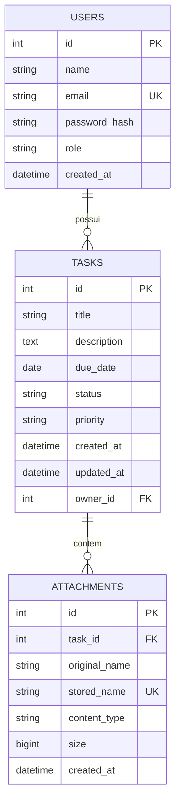

# Task Manager

API REST e interface web para organização de tarefas com anexos, autenticação e controle de acesso por perfil. Desenvolvida como desafio técnico para a vaga de Back-End da Revelatio Studio.

## Visão geral

Cada usuário cadastra e acompanha suas tarefas (título, descrição, prazo, status e prioridade) e pode anexar imagens e documentos a elas. Usuários comuns enxergam apenas as próprias tarefas. Administradores enxergam e gerenciam as tarefas de todos.

Toda a autenticação e a autorização acontecem no servidor. O front-end apenas envia o token recebido no login.

## Interface

O front-end fica em `frontend/` (React, Vite e Tailwind). Possui login e cadastro, painel de resumo, lista com filtros, busca, ordenação e paginação, formulário de tarefa com anexos, preview de imagens e PDF, e visão de administrador com o dono de cada tarefa e o resumo por usuário. Detalhes em [frontend/README.md](frontend/README.md).

## Funcionalidades

- Cadastro e login com JWT.
- Dois perfis: `USER` e `ADMIN`.
- CRUD de tarefas, com atalho para concluir.
- Filtros por status, prioridade, prazo, atraso e dono (admin), busca por texto, ordenação e paginação.
- Estatísticas por status e prioridade, com resumo por usuário para administradores.
- Upload, listagem, download e remoção de anexos, com preview via `?inline=true`.
- Validação de anexos por tipo, tamanho e assinatura do conteúdo.
- Limite de tentativas de login e logs de requisição.
- Verificações de vida e prontidão (`/health` e `/health/ready`).
- Formato único de erro, com código estável e mensagem em português.
- Documentação interativa em `/docs` (Swagger).

## Stack e decisões técnicas

### FastAPI

Gera a documentação OpenAPI automaticamente, valida entrada e saída com Pydantic e expressa autenticação e permissões como dependências, o que mantém as regras de acesso explícitas e testáveis.

### PostgreSQL

Os dados são relacionais (usuário, tarefas e anexos) e se beneficiam de chaves estrangeiras, índices e exclusão em cascata.

### SQLAlchemy 2 e Alembic

Modelos tipados e migrations versionadas. O schema nunca é criado de forma implícita na subida da aplicação.

### JWT e bcrypt

Token de acesso com expiração configurável e senhas armazenadas apenas como hash bcrypt. O perfil do usuário é lido do banco a cada requisição, nunca do token nem do cliente.

### Armazenamento de anexos

Os arquivos ficam em disco (volume no Docker) com nome gerado por UUID, e os metadados ficam no banco. O acesso é encapsulado em `app/storage`, atrás de uma interface pequena, o que permite trocar por um serviço de objetos sem alterar as rotas. Downloads sempre passam pela API, que confere a permissão antes de servir o arquivo.

### React, Vite e Tailwind

O front-end é uma SPA independente da API, publicada na Vercel. O TanStack Query cuida de cache e atualização das listas, e um cliente HTTP único converte os erros da API em mensagens para o usuário a partir do código do erro.

### Docker

`docker compose up` sobe API e banco com migrations e seed aplicados. A mesma imagem da API é usada no deploy.

## Arquitetura

```
frontend/            interface em React (src/api, components, pages, lib)
backend/
  app/
    main.py          criação da aplicação, middlewares e routers
    core/            configuração, segurança (JWT, hash), dependências e erros
    db/              engine, sessão e base declarativa
    models/          entidades SQLAlchemy
    schemas/         modelos Pydantic de entrada e saída
    routers/         camada HTTP, sem regra de negócio
    services/        regras de negócio e de acesso
    storage/         armazenamento de arquivos
    seed.py          usuários iniciais
  alembic/           migrations
  tests/             testes automatizados
docs/                documentação complementar
docker-compose.yml
```

Fluxo de uma requisição: o router recebe e valida a entrada, as dependências resolvem o usuário autenticado, o service aplica as regras de acesso e de negócio e o resultado é serializado por um schema.

## Modelo de dados



## Controle de acesso

| Ação | Usuário comum | Administrador |
|---|---|---|
| Criar tarefa | Sim | Sim |
| Listar tarefas | Apenas as próprias | Todas |
| Ver, editar e remover tarefa | Apenas as próprias | Qualquer uma |
| Anexar, baixar e remover anexo | Apenas nas próprias tarefas | Em qualquer tarefa |
| Listar usuários | Não | Sim |

Quando um usuário tenta acessar uma tarefa ou anexo de outra pessoa, a API responde `404`, o mesmo retorno de um item inexistente, para não revelar que o recurso existe. Um teste automatizado percorre todas as rotas e exige `401` sem token, exceto login, cadastro e health check.

## Como executar

### Com Docker

```bash
docker compose up --build
```

- API: http://localhost:8000
- Documentação: http://localhost:8000/docs

O seed cria dois usuários de demonstração:

| Perfil | E-mail | Senha |
|---|---|---|
| Administrador | admin@example.com | admin12345 |
| Usuário comum | user@example.com | user12345 |

### Interface

Com a API no ar:

```bash
cd frontend
npm install
cp .env.example .env
npm run dev
```

A interface abre em http://localhost:5173.

### Sem Docker

Requisitos: Python 3.12 ou superior e um PostgreSQL acessível.

```bash
cd backend
python -m venv .venv
source .venv/bin/activate        # Windows: .venv\Scripts\activate
pip install -r requirements-dev.txt
cp .env.example .env             # ajuste DATABASE_URL se necessário
alembic upgrade head
python -m app.seed
uvicorn app.main:app --reload
```

## Variáveis de ambiente

Os valores de exemplo estão em `backend/.env.example`.

| Variável | Descrição | Padrão |
|---|---|---|
| `DATABASE_URL` | Conexão com o PostgreSQL | banco local do compose |
| `ENVIRONMENT` | `production` exige `SECRET_KEY` forte na inicialização | `development` |
| `SECRET_KEY` | Chave de assinatura do JWT | valor de desenvolvimento |
| `ACCESS_TOKEN_EXPIRE_MINUTES` | Validade do token | `60` |
| `LOGIN_MAX_ATTEMPTS`, `LOGIN_WINDOW_SECONDS` | Falhas de login permitidas e janela em segundos | `5`, `900` |
| `CORS_ORIGINS` | Origens do front, separadas por vírgula | `http://localhost:5173` |
| `UPLOAD_DIR` | Pasta dos anexos | `uploads` |
| `MAX_UPLOAD_MB` | Tamanho máximo por arquivo | `10` |
| `ADMIN_EMAIL`, `ADMIN_PASSWORD` | Administrador criado pelo seed | `admin@example.com`, `admin12345` |

## Testes

```bash
cd backend
pytest
```

Por padrão a suíte usa SQLite em memória. Para rodar contra PostgreSQL, defina `TEST_DATABASE_URL`. O workflow em `.github/workflows/ci.yml` executa a suíte contra PostgreSQL 16 e valida as migrations.

Detalhes de como os testes são feitos, o que cada arquivo cobre e por que esses casos estão em [docs/TESTING.md](docs/TESTING.md).

Os testes cobrem autenticação, permissões entre perfis, CRUD de tarefas, filtros, upload e download de anexos, validações e cada código de erro do catálogo.

## API

Documentação interativa em `/docs`. Resumo das rotas:

| Método | Rota | Descrição |
|---|---|---|
| POST | `/auth/register` | Cadastro de usuário comum |
| POST | `/auth/login` | Login, retorna o JWT |
| GET | `/auth/me` | Usuário autenticado |
| GET | `/users` | Lista usuários (admin) |
| POST | `/tasks` | Cria tarefa |
| GET | `/tasks` | Lista tarefas. Parâmetros: `status`, `priority`, `q`, `owner_id`, `due_before`, `due_after`, `overdue`, `sort`, `order`, `limit`, `offset` |
| GET | `/tasks/stats` | Contagens por status e prioridade |
| GET | `/tasks/{id}` | Detalha tarefa |
| PATCH | `/tasks/{id}` | Edita tarefa |
| POST | `/tasks/{id}/complete` | Marca como concluída |
| DELETE | `/tasks/{id}` | Remove tarefa e seus arquivos |
| POST | `/tasks/{id}/attachments` | Envia um ou mais arquivos |
| GET | `/tasks/{id}/attachments` | Lista anexos da tarefa |
| GET | `/attachments/{id}/download` | Baixa o arquivo (`?inline=true` para preview) |
| DELETE | `/attachments/{id}` | Remove anexo |
| GET | `/health` | Verificação de vida |
| GET | `/health/ready` | Verificação de prontidão, inclui o banco |

Os erros seguem o formato e o catálogo descritos em [docs/ERRORS.md](docs/ERRORS.md). A descrição das camadas e das decisões está em [docs/ARCHITECTURE.md](docs/ARCHITECTURE.md).

## Deploy

A API roda no Railway com PostgreSQL gerenciado e volume persistente para os anexos. O front-end é publicado na Vercel.

- API: a definir
- Front-end: a definir

## Uso de IA

Ferramenta utilizada: Claude Code, como assistente de programação no terminal.

Partes do projeto em que foi usada:

- estrutura inicial do backend, modelos, rotas e serviços;
- testes automatizados;
- migrations e arquivos de Docker;
- interface em React (componentes, cliente HTTP e tratamento de erros);
- rascunho dos documentos em `docs/` e deste README.

Foram definidos manualmente a stack, o modelo de acesso (regras de dono e administrador), o contrato de erros e o escopo dos diferenciais. O código gerado foi executado, testado e revisado antes de cada commit.

## Vídeo de apresentação

Link: a definir

## Limitações conhecidas

- Os anexos ficam em disco local. Em mais de uma instância seria necessário um armazenamento compartilhado.
- O limite de tentativas de login fica em memória do processo e não é compartilhado entre instâncias.
- O token de acesso não possui refresh nem revogação.
- A validação de anexos confere a assinatura do conteúdo, mas não faz varredura de malware.
